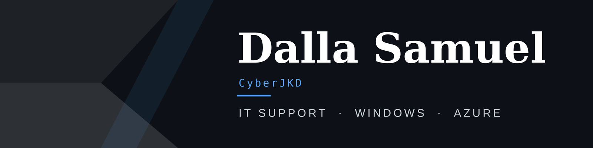

---

B.Sc. Cybersecurity · Remote on US Central hours · Every lab documented in public with the commands, failures, and fixes.

---

## Open to roles in

**IT Support / Help Desk** and **Windows systems administration**, growing toward **Junior Azure / Cloud Operations**.

### What I can do from day one

- Reset passwords, unlock accounts, and run onboarding and offboarding in **Active Directory** (GUI and PowerShell)
- Apply and verify **Group Policy**: password rules, screen lock, USB blocking
- Set up shared folders with correct **NTFS permissions**, quotas, and access auditing
- Log, prioritize, and resolve incidents in **ServiceNow** with CVSS-to-priority mapping
- Capture and read network traffic to explain what actually happened (**Wireshark**)

| **31 / 0** | **5 OUs · 4 groups** | **9 in 1 apply** | **3 real IPs** | **0 vs. 2** |
| :---: | :---: | :---: | :---: | :---: |
| Checkov passed / failed after hardening (from 19 / 17) | Active Directory built with GPO and full account lifecycle | Azure resources provisioned in a single `terraform apply` | External attackers caught by my Splunk SSH alert | Critical CVEs: unauthenticated vs. credentialed Nessus scan |

---

## Featured labs: IT support and Windows admin

### [Active Directory Environment on Azure](https://github.com/DallaSamuel/CyberJKD-Labs/tree/main/phase-03/project-02-active-directory)

- Built a Windows Server 2025 domain with **5 OUs and 4 role-based security groups**
- Group Policy: 12-character passwords, 15-minute screen lock, USB storage blocked
- Full account lifecycle in the AD GUI and PowerShell: forced-change resets, unlocks, offboarding disables, and a **90-day inactive-account audit**

**Skills:** Active Directory, Group Policy, PowerShell

### [Hardened NTFS File Server on Azure](https://github.com/DallaSamuel/CyberJKD-Labs/tree/main/phase-06/cloud-tech-techniques/cloud-system-admin-accelerator/lab-03_ntfs-file-server)

- 3-VM Windows environment deployed with Terraform, then hardened: per-user passwords in an RBAC-enabled **Key Vault**, NSG on the subnet, server public IPs removed behind a **NAT Gateway**
- Checkov results went from **19 passed / 17 failed to 31 passed / 0 failed** (7 documented exceptions)
- AGDLP NTFS permissions on 4 shares with Access-Based Enumeration, FSRM quotas, and audit logging that **captured a denied access attempt**

**Skills:** Terraform, Key Vault, NAT Gateway, Checkov, NTFS/AGDLP, FSRM, GPO, PowerShell

### [ServiceNow Vulnerability Ticketing](https://github.com/DallaSamuel/CyberJKD-Labs/tree/main/phase-02/project-03-servicenow-vulnerabiity-ticketing)

- Logged 6 findings as **parent/child incidents** with CVSS-to-priority mapping
- Registered the Azure VM as a **CMDB configuration item**
- Resolved 2 incidents with documented fixes

**Skills:** ServiceNow, incident management, CMDB

---

## Cloud & Infrastructure as Code

### [Terraform Active Directory Domain Controller](https://github.com/DallaSamuel/CyberJKD-Labs/tree/main/phase-06/cloud-tech-techniques/cloud-system-admin-accelerator/lab-01_terraform-ad-dc)

- Azure network and a Windows Server 2022 domain controller in a **single `terraform apply`** (9 resources), then a clean `terraform destroy` with zero leftover cost
- Debugged real failures: SKU capacity, quota, state drift, and a Gen1/Gen2 image mismatch

**Skills:** Terraform (HCL), Azure VNet/NSG/NIC, Custom Script Extension, AD DS forest promotion

*Next: Microsoft Entra ID with Azure RBAC, Azure Monitor and storage.*

---

## Monitoring, Vulnerability Management & Analysis

- **[Splunk Enterprise SIEM on Azure](https://github.com/DallaSamuel/CyberJKD-Labs/tree/main/phase-02/project-01-splunk-siem-lab):** live Linux auth logs, 3 SPL detections, and a High-severity **Brute Force SSH alert** and dashboard that surfaced probing from **3 real external IPs within hours**
- **[Nessus Vulnerability Scanning on Azure](https://github.com/DallaSamuel/CyberJKD-Labs/tree/main/phase-02/project-02-nessus-vulnerability-scanning):** unauthenticated vs. credentialed scans across two regions (**0 vs. 2 Critical CVEs**, CVSS 9.8 and 9.1) and a 6-action remediation plan
- **[Malware Analysis & Reverse Engineering](https://github.com/DallaSamuel/CyberJKD-Labs/tree/main/phase-04/cyb405-ethical_hacking_coursework_(miva)/cyb405_lab-05_malware-analysis-%26-reverse-engineering):** C2-simulation binary analyzed with strings, readelf, strace, tcpdump, and Ghidra; 5-row IOC table and a Suricata rule to detect the beaconing

---

## Networking & Foundations

- **[Wireshark & Network Analysis on Azure](https://github.com/DallaSamuel/CyberJKD-Labs/tree/main/phase-03/project-03-wireshark-network-analysis):** traced DNS lookups and TCP/TLS handshakes on a Windows 11 VM with display filters and TCP stream reconstruction
- **[Network Segmentation with pfSense](https://github.com/DallaSamuel/CyberJKD-Labs/tree/main/phase-01/project-02-network-segmentation):** WAN/LAN/DMZ with isolation verified by ping tests
- **[Ubuntu Server Hardening (VM)](https://github.com/DallaSamuel/CyberJKD-Labs/tree/main/phase-01):** root login disabled, SSH limited to 3 attempts, UFW default-deny with only port 22 open, locked-down file permissions, empty-password audit; verified with before/after port scans and an SSH check from Kali
- **[Linux Hardening Lab](https://github.com/DallaSamuel/linux-hardening-lab) + [Hardening Script](https://github.com/DallaSamuel/linux-hardening-script):** Kali (WSL2) audit that disabled 4 unnecessary services (closing exposed RDP ports 3389 and 3350), key-only SSH, UFW, and a Bash script that audits ports before and after
- **[Brute Force Simulation + Detection](https://github.com/DallaSamuel/CyberJKD-Labs/tree/main/phase-01/project-05-brute-force-simulation):** attacked with Hydra, detected with a Python log parser, blocked with UFW, verified the block

---

## Toolbox

- **Windows & Identity:** Active Directory, Group Policy, NTFS/AGDLP, FSRM, PowerShell
- **Cloud & IaC:** Azure, Terraform, Key Vault, NSG, NAT Gateway, Checkov, Azure CLI
- **ITSM & Scripting:** ServiceNow, Python 3, Bash, Git
- **Security & Monitoring:** Splunk, Nessus, Wireshark, Suricata, Ghidra, Hydra

---

## Live GitHub activity

---

**Becoming dangerous through fundamentals.**

[Roadmap](https://dallasamuel.github.io/CyberJKD-Roadmap) · [LinkedIn](https://www.linkedin.com/in/dallasamuel) · [Book a call](https://calendly.com/dallasamuel/intro-call)

